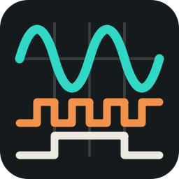
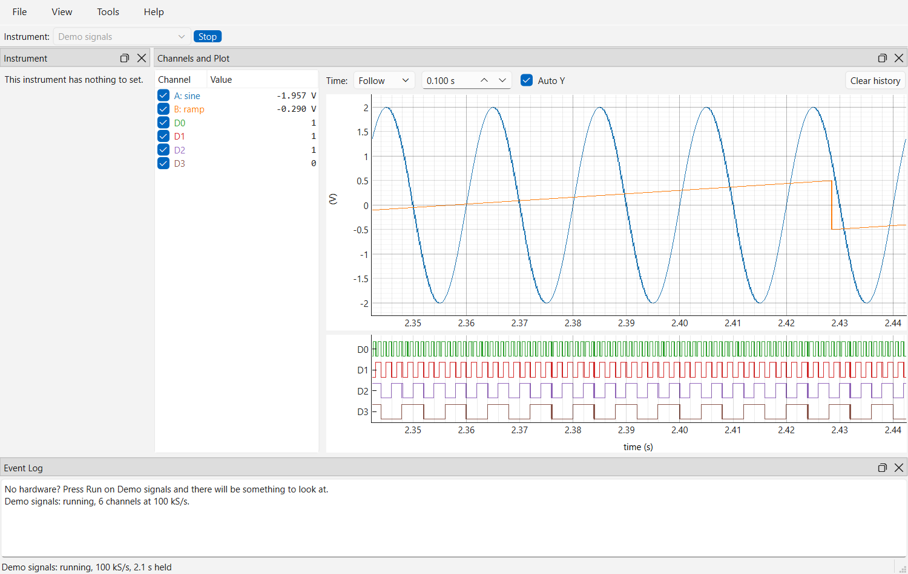

<p align="center">
  
</p>

# pyscopegui

[](https://github.com/davhodg/pyscopegui/actions/workflows/ci.yml)
[](https://github.com/davhodg/pyscopegui/releases)
[](https://pypi.org/project/pyscopegui/)


Oscilloscopes and logic analysers in one view: analog and logic channels from separate instruments, on one time axis. Apache-2.0.



**This is an early version.** The window, the panes, the build and the installer are in place, with a built-in demo that needs no hardware and back ends for the PicoScope 2204A and the Rigol DS1000Z series.

## What it does

- **Channels and Plot**: analog channels on one plot and digital channels in lanes under it, on the same time axis. Drag or zoom either and both move.
- **Auto Y**, on to start with, fits the voltage axis to the signal; unticked, the axis is the range the channels are set to, as on a scope's screen.
- **Deep captures stay quick**: the last ten seconds of every channel are held, or up to ten minutes if you ask, and what is drawn is cut down to a lowest and a highest per column of the screen, so a spike narrower than a pixel is still drawn.
- **Open and Close**, and a scope's own **Stop, Single, Normal and Auto**, with a trigger on any channel: rising or falling, at a level, placed anywhere in the plot.
- **Several instruments at once**: open one, choose another and open that too. Each has its own trigger, and nought on the time axis is each one's trigger, so two instruments triggered by the same edge line up.
- **Instrument** pane: the settings of whichever instrument is chosen, built from what its back end says it has. A scope's channels are set one at a time, and how every channel is set is read beside its name in the plot's list: click one there to change it.
- **The same settings on every scope**: volts a division, probe and coupling, whichever maker's it is.
- **Panes** that dock, float, detach into windows of their own and pin on top, with the arrangement remembered. More than one plot can be open at once.
- **Event Log**: everything the application has to say, with warnings and errors in their own colours.
- **Light and dark** themes, or whichever the system is set to.

Full details are in [the manual](pyscopegui/help/manual.md), which is also under **Help > Documentation** in the application. What each version added, changed and fixed is in [the changelog](pyscopegui/help/changelog.md), which is part of the manual too.

## Instruments

- **Demo signals**: two analog and four digital channels, with no hardware.
- **PicoScope 2204A**, and the other scopes on Pico's `ps2000` driver (2202, 2203, 2204, 2205, 2205A): both channels, streamed continuously at up to 1 MS/s, or read in short blocks at up to 100 MS/s around the scope's own trigger.
- **Rigol DS1000Z series** (DS1054Z, DS1074Z, DS1104Z, and the Plus, -S and MSO models), over the network: the four analog channels, a sweep at a time around the scope's own trigger, read from its screen or its whole memory. The logic inputs and signal generator that some models have are not used yet. Nothing of Rigol's needs installing.

Pico's library is not bundled. Install the PicoSDK from [picotech.com/downloads](https://www.picotech.com/downloads). If Pico's own PicoScope 7 is running, close it first, since only one program can have the scope open.

The **Instrument** pane sets the scope up: sample rate, and each channel's scale in volts a division, probe, coupling and whether it is read at all. The scope is opened once and kept open, so starting, stopping and changing a setting are quick.

The pane also drives the scope's **signal generator** output: off, sine, square or triangle, with frequency, peak-to-peak amplitude and offset. It is off until you choose a waveform, and changes take effect while the scope runs, with a short gap in the plot while it is set.

## Installing

There are three options:

1. **With pip** -- from [PyPI](https://pypi.org/project/pyscopegui/), into whichever Python environment you choose. Python 3.12 or newer is needed.

   To install it:

   ```
   pip install pyscopegui
   ```

   To run it:

   ```
   pyscopegui
   ```

   To update it:

   ```
   pip install --upgrade pyscopegui
   ```

   It is an ordinary Python package with an ordinary entry point, so the choice of environment is yours.

2. **The Windows installer** -- `pyscopegui-<version>-setup.exe` from the [releases page](https://github.com/davhodg/pyscopegui/releases). Nothing else is needed: **not even Python.** It installs a self-contained application, offers a desktop shortcut, and uninstalls cleanly.

   It asks first who it is for: **everybody who uses the computer**, which needs administrator rights, or **only you**, which does not.

3. **From a Git clone** -- clone the repository, then double-click `pyscopegui.cmd` (Windows) or run `./pyscopegui.sh` (Linux). This is the way to have the latest changes before they are released, or to contribute. Python 3.12 or newer must be on the PATH.

   The first run sets itself up: it creates a *virtual environment* -- a folder called `.venv` holding its own copy of Python and only the libraries pyscopegui needs, so nothing else on the machine is touched -- and downloads a couple of hundred megabytes into it. That takes a few minutes once; every later start is immediate, and deleting `.venv` undoes the whole thing. If `uv` is installed it is used instead of pip.

**On Linux**, however pyscopegui is installed, Qt needs a system library to draw the window, and Debian, Ubuntu, Linux Mint and the like often leave it out:

```
sudo apt install libxcb-cursor0
```

pyscopegui names any that are missing as it starts.

**Where your own files are kept** is the same whichever way it was installed: `%APPDATA%\pyscopegui` on Windows and `~/.config/pyscopegui` on Linux. Upgrading and uninstalling leave that folder alone.

## Supported systems

**Windows and Linux**, on **Python 3.12 or newer**. The CI workflow runs the tests on both on every push. The installer is for Windows only.

## Built with

pyscopegui is Apache-2.0 and is a pure-Python application on top of these packages, each used unmodified under its own licence. The LGPL components stay separate, replaceable packages, as the LGPL requires.

| Package | Used for | Licence |
|---------|----------|---------|
| [Python](https://www.python.org) | Runtime | PSF-2.0 |
| [PySide6-Essentials](https://www.qt.io/qt-for-python) | GUI toolkit (Qt for Python) | LGPL-3.0 (used under LGPL) |
| [shiboken6](https://www.qt.io/qt-for-python) | Qt binding runtime used by PySide6 | LGPL-3.0 (used under LGPL) |
| [pyqtgraph](https://www.pyqtgraph.org) | Plotting | MIT |
| [numpy](https://numpy.org) | Sample arrays | BSD-3-Clause (with 0BSD / MIT / Zlib / CC0 parts) |

Only LGPL Qt modules are used (QtCore, QtGui, QtWidgets). pyscopegui depends on **PySide6-Essentials** rather than the full PySide6, so the GPL-only add-on modules (Qt Charts, Qt Data Visualization and the rest) are never installed.

## Contributing

See [CONTRIBUTING.md](CONTRIBUTING.md): setting up, running the tests, and building the Windows installer. Everyone taking part is asked to follow the [code of conduct](CODE_OF_CONDUCT.md), and security problems go through [SECURITY.md](SECURITY.md).

## Safety notice

pyscopegui shows what instruments connected to real equipment measure. A scope's ground clip is connected to the computer's ground unless the scope or its USB connection is isolated, and clipping it to a point that is not at ground can damage the equipment, the scope and the computer. Know what you are connecting to before you connect.

## Licence

pyscopegui is free software, provided under the Apache License 2.0, without warranty of any kind; see [LICENSE](LICENSE) and [NOTICE](NOTICE).

Development has made use of Anthropic's Claude.
